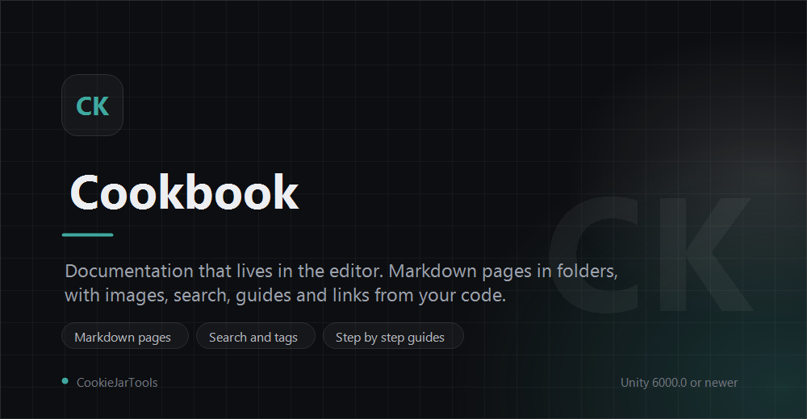

<p align="center">
  
</p>

<h3 align="center">Documentation that lives in the editor, so the answer is where the work is.</h3>

## Install

Unity 6000.0 or newer.

**In the Package Manager**

1. Open `Window > Package Manager`
2. Press **+**, then **Install package from git URL**
3. Paste this and press Add:

```
https://github.com/CookieJarTools/Cookbook.git
```

**Or by hand**, put this line in `Packages/manifest.json`:

```json
"com.cookiejartools.cookbook": "https://github.com/CookieJarTools/Cookbook.git"
```

## What it does

Markdown pages, in folders, read inside Unity. Images, tables and code blocks all render. The whole
lot is searchable, and pages can carry tags so a large set stays findable.

**Step by step guides.** A page can be a guide: each step is a button, and pressing it does the
thing the step describes, so a reader follows along rather than reading about it.

**Links from your code.** A page can point at a type, and a type can point back, so the explanation
sits next to what it explains.

**Your project's own markdown turns up too.** Any markdown among your assets is listed beside the
pages you write, so a readme buried three folders down is no longer lost.

## Using it

Open **Window > CookieJarTools > Cookbook**.

Pages are markdown files in a `Docs` folder at the top of your project, next to `Assets` rather
than inside it, so they are not imported and do not end up in a build. Write them in the editor or
in any text editor you like.

## Licence

MIT. See [LICENSE.md](LICENSE.md).
