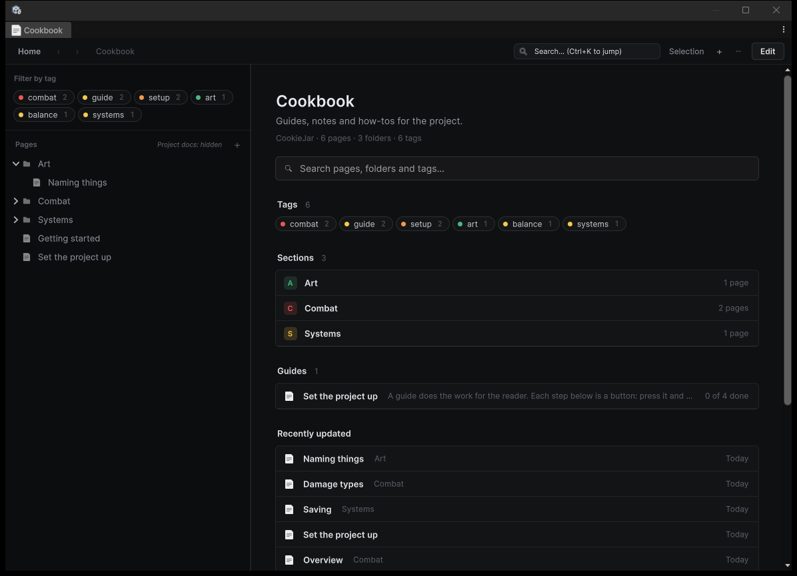
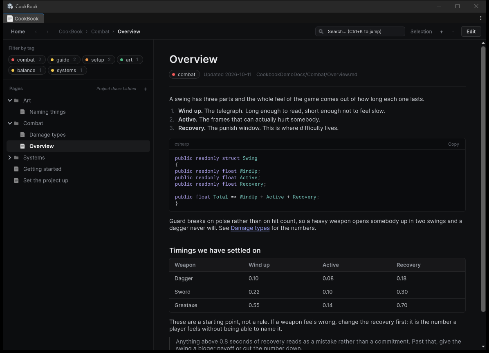
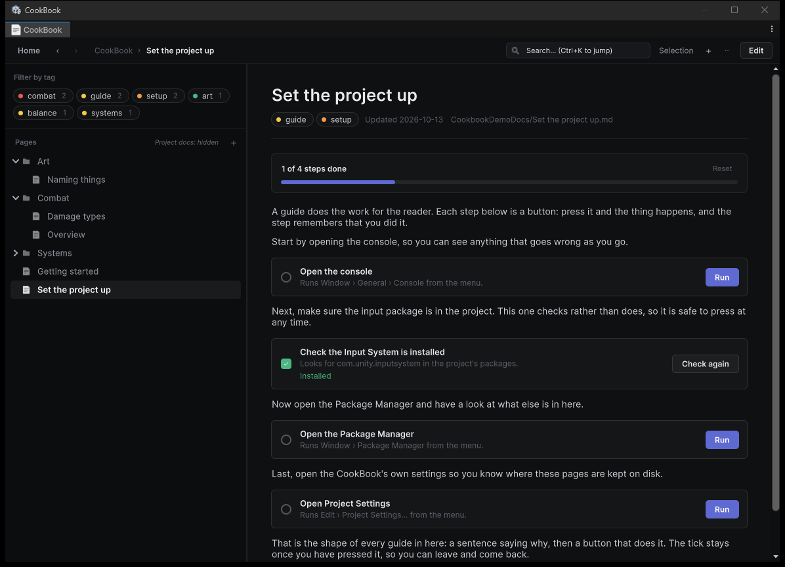
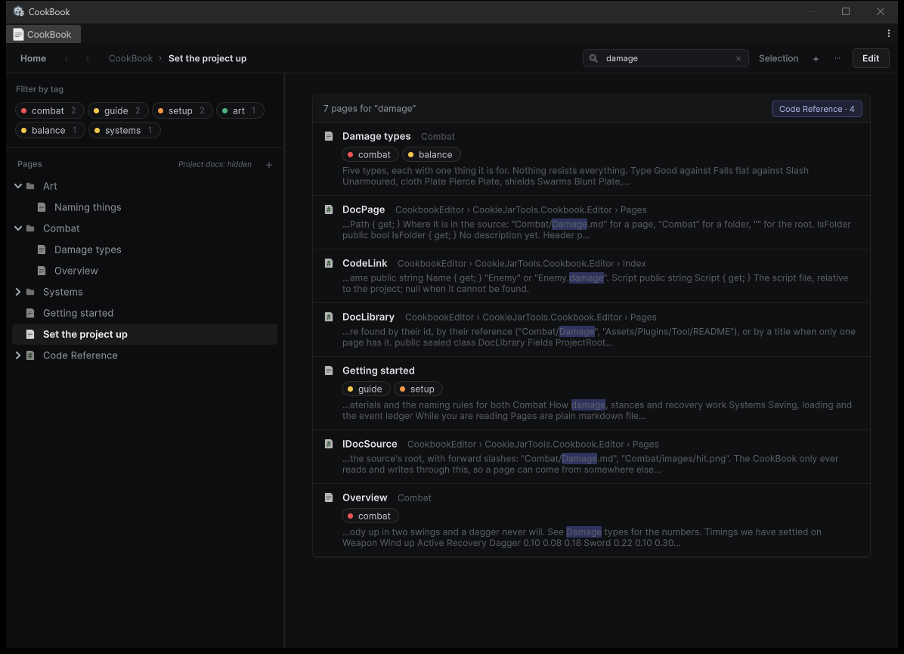

<p align="center">
  
</p>

<h3 align="center">Documentation that lives in the editor, so the answer is where the work is.</h3>

<p align="center">Open it from <b>Window &gt; CookieJarTools &gt; Cookbook</b></p>

## Install

Unity 6000.0 or newer.

**In the Package Manager**

1. Open `Window > Package Manager`
2. Press **+**, then **Install package from git URL**
3. Paste this and press Add:

```
https://github.com/CookieJarTools/Cookbook.git
```

**Or by hand**, put this line in `Packages/manifest.json`:

```json
"com.cookiejartools.cookbook": "https://github.com/CookieJarTools/Cookbook.git"
```

## What it is

Pages are plain markdown files in a `Docs` folder at the top of your project, next to `Assets`
rather than inside it, so Unity never imports them and no build carries them. Write them in the
Cookbook or in any editor you like. A saved file shows up straight away.

Because they are just files, they live in version control beside the code they describe, and a
branch that changes how something works can change the page about it in the same commit.

<p align="center">
  
</p>

The front page counts what you have, groups it, and puts the pages you touched last within reach.
Tags are declared at the top of a page and become filters down the left.

## Pages

Markdown, rendered properly: headings, lists, tables, quotes, images, and code with syntax
highlighting and a copy button. Links between pages are links, not paths to go and find.

<p align="center">
  
</p>

A few lines at the top of a file carry its tags and the date it was updated:

```markdown
---
tags: [combat, balance]
updated: 2026-10-11
---
```

A page without them is fine. The Cookbook adds what it needs the first time it saves one.

## Guides that do the work

A guide is a page whose steps are buttons. Press one and the thing happens: a menu item runs, an
asset is created, a window opens. A step can also be a check, which looks at the project and tells
you whether something is already in place.

<p align="center">
  
</p>

```markdown
[Open the console](action:menu/Window/General/Console)

[Check the Input System is installed](check:package/com.unity.inputsystem)
```

The tick stays once a step is done, so somebody can walk away and come back. Only the actions
above and methods you have marked yourself can be run, so a page cannot be made to do anything
you have not allowed.

## Finding things

Search covers every page, and the Code Reference alongside them, with the matching words shown in
place. **Ctrl+K** jumps straight to a page by name.

<p align="center">
  
</p>

## The Code Reference

Point the Cookbook at a folder or an assembly definition and it reads your types and their XML
comments into pages of their own, kept up to date with the code.

Code can point back. Mark a class, field, property or method with `[Documentation]` and the
inspector grows a small link to the page that explains it, so somebody poking at a component in
the scene is one click from the reason it works that way.

```csharp
[Documentation("Combat/Damage types")]
public DamageType Type;
```

Name the page by its path, which is easier to write, or by the id in its header, which keeps
working when the page is renamed or moved. Right click a page in the tree and choose
**Copy [Documentation] Attribute** to get one ready to paste.

## Markdown already in your project

Any markdown among your assets is listed beside the pages you write, so a readme buried three
folders deep is no longer lost. Turn it off if you would rather only see your own.

## Licence

Free to use, including in games you sell, under the PolyForm Shield License 1.0.0.
The one thing it does not allow is using it to make something that competes with the
tool itself. See [LICENSE.md](LICENSE.md).
